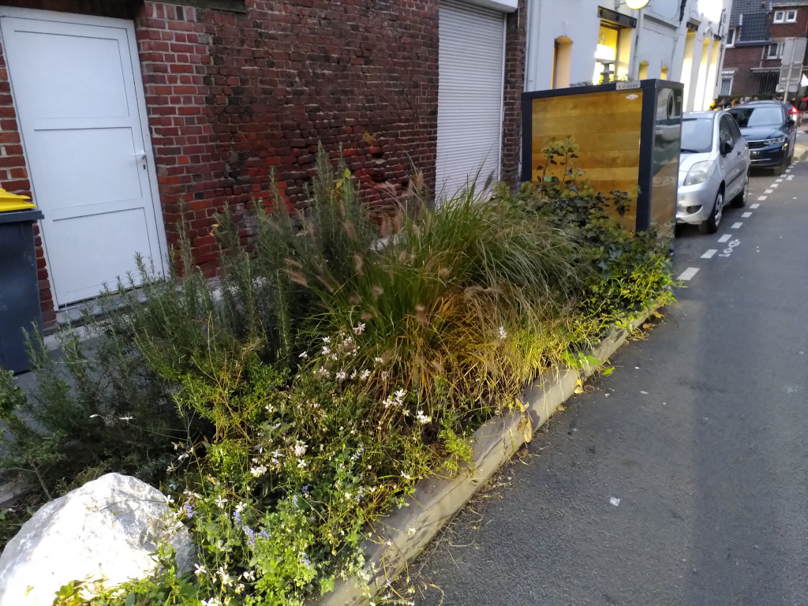
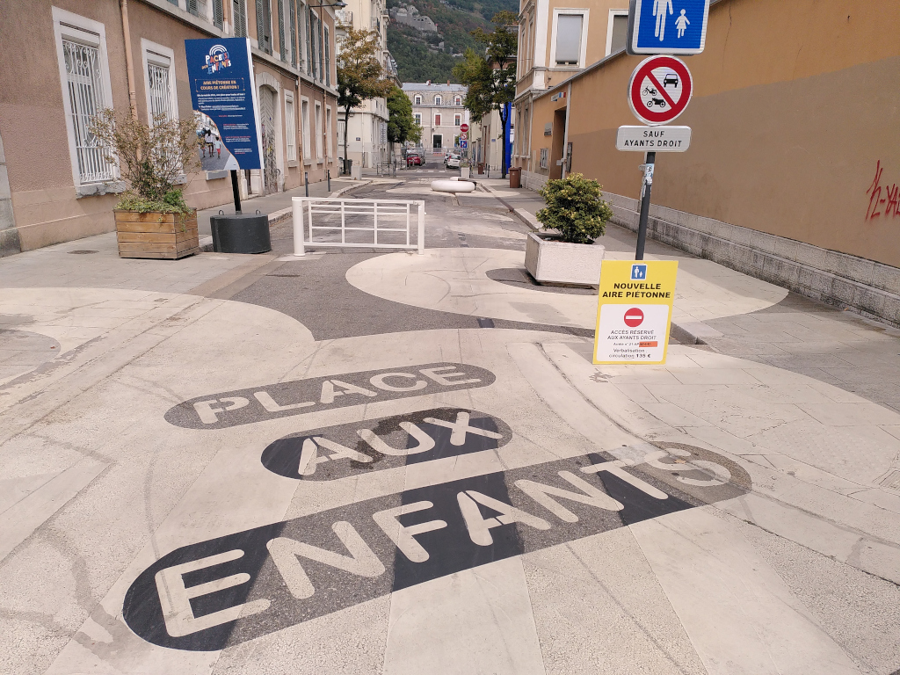
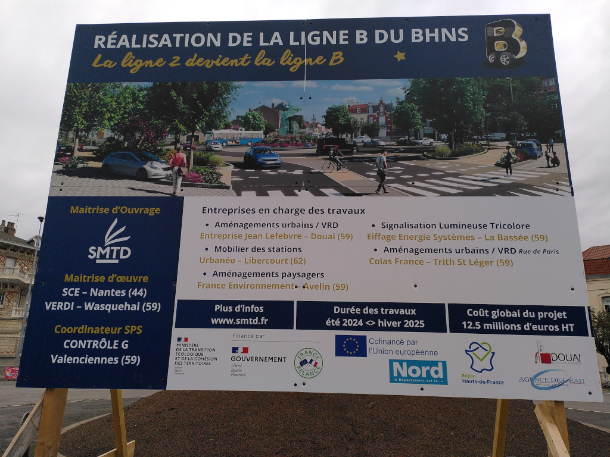
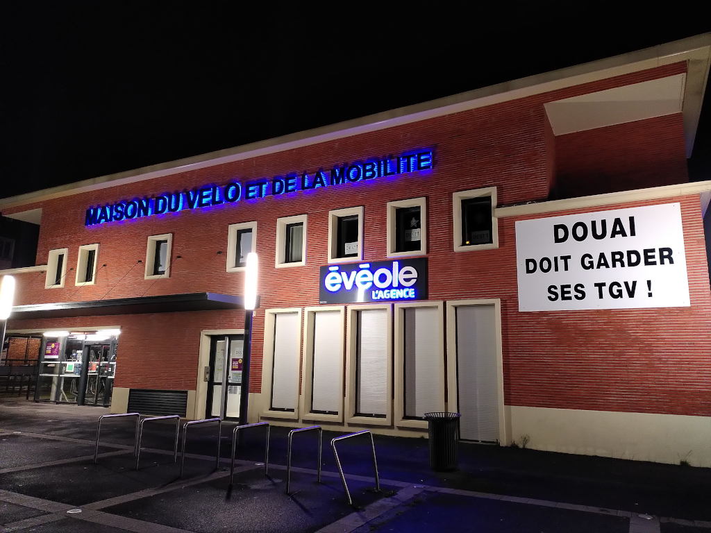
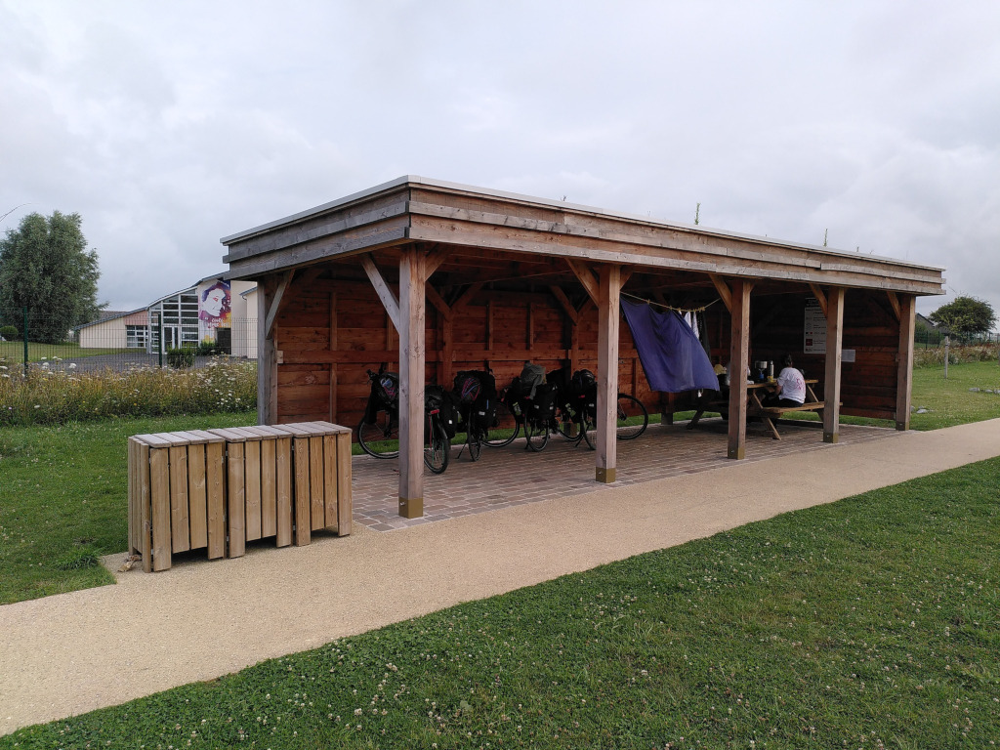
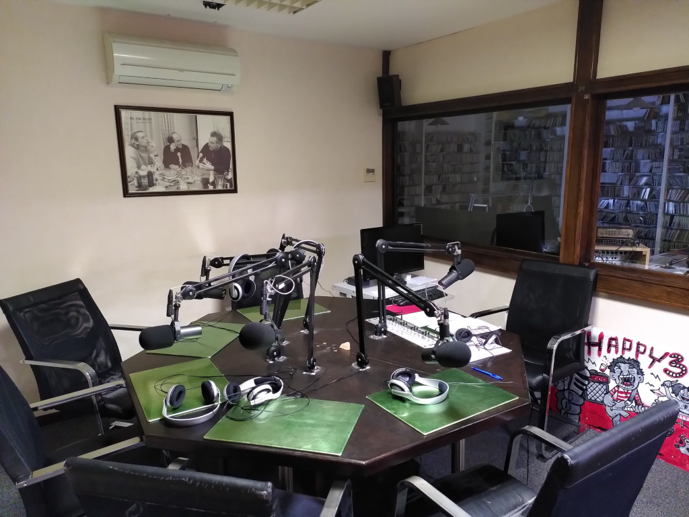
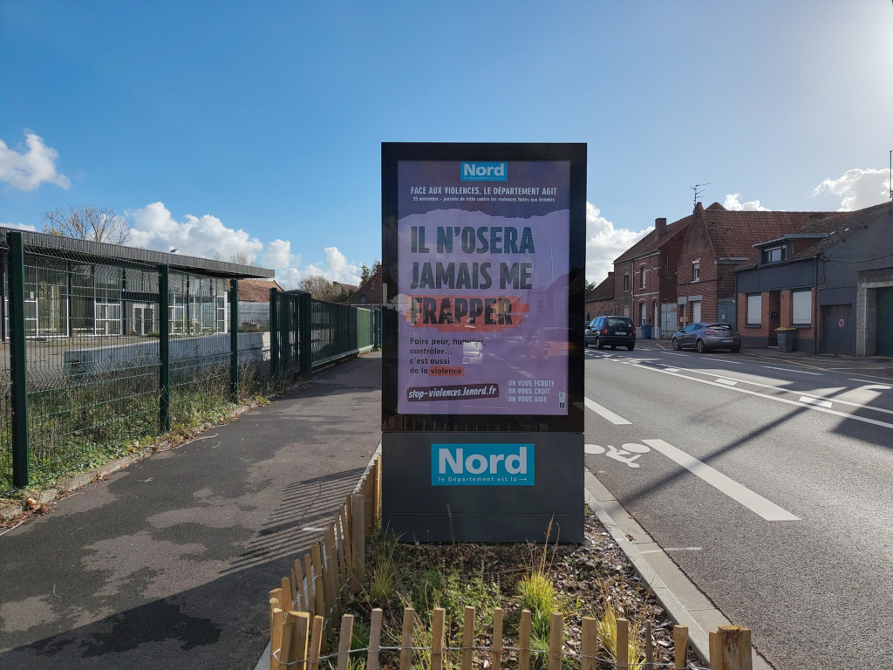
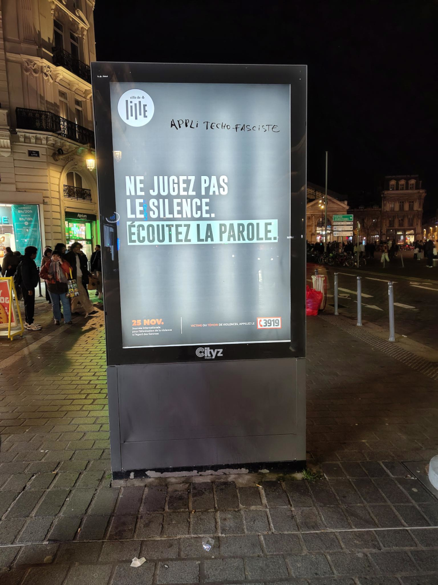

# Mes idées pour Douai

La ville de Douai lance une opération de communication pour donner ses idées pour Douai, je me suis prêté au jeu !

## Le principe

Le principe est simple : proposer des idées relevant des compétences de la ville (Culture, Patrimoine, Sports,Loisirs, Cadre de vie, Environnement, Mobilité, Accessibilité, Education, Jeunesse, Commerces, Attractivité, Solidarités, Citoyenneté, Prévention ou Sécurité).

Ces idées doivent être des dépenses d’investissement (ce qui est parfois difficile à déterminer). Il y a clairement de nombreuses participations qui sur ce point n’entrent pas dans ce critère (saurez-vous trouver lesquelles parmi les miennes 😅). Elles ne seront peut-être donc pas retenues.

Elle doivent également représenter un budget maximum de 25 000€ ce qui n’est pas toujours évident non-plus. Nous verrons donc bien ce qui sera déclaré comme éligible.

## Mes idées

J’ai donc pris la liberté de proposer mes idées sans être totalement sûr de leur éligibilité, les voici suivies des idées que je soutiendrai probablement une fois la phase de choix démarrée.

### Créer des îlots de la transition

En lieu et place de quelques places de parking, créer des îlots de la transition un peu partout dans Douai. Ces îlots permettraient de favoriser les pratiques écologiques et de rajouter de la verdure dans les rues. Ils pourraient proposer :

- de la végétalisation, notamment des herbes aromatiques qui ont de plus une utilité (cf photographie),
- des bancs pour pouvoir se poser, créer du lien,
- des points d’apport volontaires (j’ai proposé la place Esméralda dans le champ lieu car il y a souvent des dépôts sauvages, cf photo aussi),
- des box à vélo (dans les secteurs résidentiels où les logements ne permettent pas de stocker un vélo),
- accueillir des composteurs collectifs,
- … l’imagination est la seule limite.

L’idée est de permettre le développement des pratiques écologiques tout en sensibilisant à l’espace occupé par l’automobile et les gains possible si on lui reprend un peu de terrain. Afin de bénéficier de l’assentiment des riverain·es, il me semble utile de mettre en jeu plusieurs îlots chaque année et de demander quels habitant·es seraient volontaires pour les accueillir dans leur rue.

Cette idée est une amélioration de celle que nous avons proposé avec les conseils de quartiers et l’association Droit d’Vélo au sujet des box à vélo (j’y reviendrai bientôt sur ce blog).

### Aménager une rue aux écoles

Les rues aux écoles permettent aux enfants de prendre possession de la rue qui se situe devant leur école. Certaines municipalités (comme la ville de Grenoble nommée capitale verte européenne) ont dors et déjà fait le choix de les multiplier.

Moyennant quelques barrières et de la peinture au sol, il est relativement aisé de les créer ainsi que d’installer quelques agrés (voir photo prise justement à Grenoble).

Plusieurs rues me semblent appropriées : la rue Saint Jean, la partie devant l’école de la rue d’Alsace Lorraine…

Moins de pollution, moins d’accidents (parfois mortels). C’est tout ce que l’on peut souhaiter pour nos bouts de chou.

### Transformer le rond point porte de Valenciennes en rond point à la Hollandaise

Actuellement, le rond point de Valenciennes est accidentogène. Les cyclistes et les piéton·nes n’y sont pas en sécurité, notamment à cause de problèmes de vitesse, mais aussi, de visibilité (surtout en venant de Sin-le-Noble) et enfin, d’aménagement car les automobilistes serrent la corde en sortie de rond point et mordent donc sur les pistes cyclables. J’ai failli être renversé récemment de ce fait.

Le rond point de la place l’Hériller sera bientôt réaménagé avec un [rond point qui est (presque) à la Hollandaise](./ligne-b-du-bhns-et-le-velo) (il manque une continuité dans la masse de la piste cyclable, il faudrait qu’elle soit matérialisée en dur et non uniquement via de la peinture, j’ai interpelé Jean-Michel Leroy, adjoint à la voirie, à ce propos hier, lors de la cérémonie de renouvèlement des jumelages de Seraing et Pulawy). C’est une bonne avancée, mais pour favoriser la compréhension de ce type de rond point, qui représente l’avenir, il serait judicieux d’avoir un plan d’harmonisation des ronds points d’entrée de ville.

Transformer celui de la porte de Valenciennes en ajoutant des olives aux intersections pour empêcher les véhicules de mordre sur la piste et en matérialisant la priorité aux cyclistes en entrée et en sortie de rond point devrait coûter moins de 25 000€ et améliorerait significativement la vie des cyclistes à cet endroit.

### Poser des panneaux solaires parc Charles Fenain

Les bâtiments du Parc Charles Fenain ont de larges toitures (mais relativement accessibles) qui pourraient accueillir des panneaux solaires. Aujourd’hui, une installation de taille modeste coûte moins de 25 000€, ce serait donc un bon premier pas vers une ville qui prend son avenir énergétique en main.

L’électricité photovoltaïque est propre et renouvelable. Les panneaux sont recyclables et leur coût a drastiquement diminué ces dernières années quand leur performance a explosé. C’est aussi une fierté pour un territoire de produire sa propre électricité.

### Campagne d’affichage contre les VSS

Exploiter les différents espaces d’affichage pour lutter contre les violences sexistes et sexuelles ou l’éducation au consentement.

Les supports possibles :

- les espace de pub gérés par la mairie (contrat JC Decaux) ou le département (ClearChannel),
- les espaces d’affichages dans les bus du SMTD (qui contiennent des messages contre la fraude alors que c’est gratuit aujourd’hui),
- les centres sociaux, écoles et MJC.

Pour ne pas dépasser le budget de 25 000€, il est possible d’utiliser des affiches toutes faites (le gouvernement ou des associations ont créé plusieurs affiches de ce type).

L’insécurité ressentie ou vécue est un problème pour vivre la ville en toute liberté quelque soit son genre, sa couleur de peau ou son handicap.

Il me semble plus utile d’exploiter les affichages publicitaires pour lutter contre les VSS et faire avancer la société que [pour les vœux par exemple](./3615-code-qui-n-en-voeux).

### Remplacer le panneau "Douai doit garder ses TGV" par un message positif

Les récentes et multiples suppressions de TGV à Douai ont démontré qu’un panneau ne peut rien contre l’idéologie de la rentabilité pour le service public.

En revanche, ce panneau contribue à développer une image de ville en déclin pour Douai. Il s’agit, pour les personnes qui prennent le train, du premier message reçu en arrivant à Douai (si l’on exclue la publicité en gare…). Parmi ces personnes, il y a peut-être des personnes qui pourraient vouloir s’installer à Douai et seraient refroidies par ce message.

Cela va à l’encontre des efforts fait pour casser l’image de ville en voie de paupérisation qui colle, souvent à tort, aux villes du bassin minier.

Il serait bon de remplacer ce panneau pour un message positif : "Douai ville, en transition", "Douai, la campagne en ville", "Douaisien·nes au premier regard"… pourquoi d’ailleurs ne pas lancer un appel à idées pour ce dernier.

L’idée est de propager une bonne image de la ville et de sortir de la sinistrose d’un affichage qui a démontré son inefficacité.

### Des toilettes publiques rue de Bellain

La ville de Douai a pour projet de créer des toilettes publiques un peu partout dans Douai. C’est bien, mais, il faut que ces toilettes soient installées dans des lieux de passage. Celles installées place Schumann sont isolées et surtout, créent de l’artificialisation (autrefois, il y avait des arbres).

Il me semble donc important de privilégier des toilettes dans des bâtiments existant, notamment, rue de Bellain (ou de la Mairie ou St-Jacques…). Cela aurait plusieurs avantages :

- économiser l’espace public,
- remplir des bâtiments détenus par la mairie qui n’ont pas d’usage et donc éviter la sensation de vide,
- économiser de l’argent public (moins cher que de créer de zéro un bâtiment),
- avoir des toilettes publiques bien visibles car en front de rue,
- améliorer la sécurité des personnes les utilisant car dans des lieux de passage.

### Mieux signaler les toilettes de l’Hôtel de Ville

Les toilettes de l’Hôtel de Ville sont méconnues de certaines personnes se rendant peu à la mairie ou simplement des personnes de passage. Il serait bon d’afficher, dans toutes les rues commerçantes, des panneaux indiquant la direction pour accéder aux WC et leurs horaires d’ouverture.

## Mes coups de cœur

D’autres idées ont été publiées, voici une petite sélection de mes coups de cœur parmi ces belles idées proposées :

- championnat de la tarte au sucre : la fameuse "Tarte au chuc" du Nord, probablement ma tarte préférée, alors oui pour un concours qui crée du lien et réchauffe les cœurs (mais à faire dans le centre ville, à l’extérieur),
- composteurs collectifs, box à vélo résidentiels : ces idées, répétées sous différentes formes, recoupent mes îlots de la transition, preuve qu’il y a un intérêt pour cela à Douai,
- bricothèque : mettre nos outils en commun est une très belle idée mise en œuvre dans de nombreuses villes écologistes,
- kiosque place Saint-Amé : j’ai proposé la même idée pour le parc Bertin. Je trouve que les kiosques, autrefois présents, permettent de favoriser la rencontre et les activités de plein air. À favoriser dans une ville qui souhaite ouvrir le cœur de ses habitant·es vers plus de solidarité et de vivre ensemble,
- plantation d’arbres fruitiers : j’ai eu l’occasion de m’exprimer à de nombreuses reprises sur ce sujet et je suis ravi de voir que les Douaisien·nes le souhaitent également.

---

## Note rétrospective du 10 juin 2025

Finalement, 4 de ces idées ont été retenues et proposées au vote des Douaisien·nes :

- le rond point à la Hollandaise porte de Valenciennes (estimé à 25 000€),
- les panneaux solaires du parc Charles Fenain (estimé à 15 000€),
- la rue aux écoles à Frais-Marais (estimé à 25 000€),
- et les panneaux demandant l’arrêt des moteurs devant les écoles (estimé à 2 000€).

Ne disposant que de 3 votes, j’ai choisi les trois premières, la quatrième pouvant être faite à peu de frais. Je vous incite donc à voter si vous avez envie de les voir advenir et vous donne rendez-vous pour les résultats.

---

## Note rétrospective du 13 août 2025

Malheureusement, ces projets, à quelques votes d’être réalisés, n’ont pas été retenus. Le classement est le suivant :

- micro-oasis en centre-ville (235 voix),
- cour conviviale au centre social du Faubourg de Béthune (169 voix),
- parcours pour découvrir le patrimoine (158 voix),
- un caniparc pour nos amis à 4 pattes (155 voix),
- Douai en lettres géantes (107 voix).

Du côté de mes propositions :

- sécurisation du rond-point de la porte de Valenciennes (99 voix),
- panneaux solaires au parc Charles Fenain (83 voix),
- une rue aux écoliers (78 voix),
- panneaux « à l’arrêt coupez votre moteur » devant les écoles (52 voix).

Une déception, mais ces propositions ont été ajoutées au [programme des écologistes pour les élections municipales de 2026 pour Douai et les communes du Douaisis](https://drive.google.com/file/d/1k7kcU7axwzPrBpL2jeRF3PPtuga5FeNM/view?usp=sharing) !

---

## Note rétrospective du 31 octobre 2025

Le panneau Douai doit garder ses TGVs a été supprimé. Mon idée de le remplacer n’a pas été mise en œuvre mais je ne désespère pas.

---

## Note rétrospective du 5 novembre 2025

Pour la deuxième édition du budget participatif, j’ai repris l’idée des panneaux solaires au parc Bertin et ajouté les idées suivantes.

### Des préaux étape en bord de scarpe

Lors de voyages à vélo, on a parfois la chance de tomber sur des aménagements exceptionnels. Un préau étape en bord de scarpe avec quelques tables de pique-nique comme sur l’illustration serait vraiment utile pour les vélotouristes ou les marcheurs. Pourquoi pas juste avant Arkéos par exemple.

### Une flotte de vélos pour un collège / lycée

Certaines écoles / lycées / collèges doivent payer des bus pour aller à la piscine / au stade. À pieds, cela prend beaucoup trop de temps sur la séance de sport. Mettre en œuvre une flottille de vélos pour leur permettre de s’y rendre ferait des économies, réduirait les émissions et permettrait également de faire aimer le vélo aux enfants. Attention, prévoir une alternative pour les personnes à mobilités réduites / qui ne savent pas rouler à vélo (partenariat vélo école Droit de Vélo, tricycles électrique…).

## Un studio d’enregistrement de podcast / table ronde à la maison des associations

La création d’un studio d’enregistrement/diffusion audio/video pour podcasts, émissions de débat etc… à la maison des associations.

En effet, de nos jours, ce matériel est peu onéreux, tant et si bien que de nombreux amateur-euses en sont équipés.

Ceci permettrait aux associations, mouvements politiques, écoles et même créateur-ices de contenus de bénéficier d’un lieu pour enregistrer des contenus de qualité.

L’expression populaire en serait renforcée et de nouveaux médias citoyens pourraient y naître !

La photo d’illustration est le studio de Radio Scarpe Sensée, radio locale bien connue du Douaisis.

### Un mur d’escalade en extérieur au parc Jacques Vernier

Cette une idée proposée par ma fille, grande fan d’escalade.

L’air des salles d’escalades est pollué à cause des micro-plastiques, de l’usure des équipements de sports, de la magnésie en suspension… c’est pourquoi je voudrais avoir un mur d’escalade en extérieur au Parc Jacques Vernier qui est assez grand pour l’accueillir. Il faudrait un mur initiatique pas trop haut et un mur confirmé qui soit vraiment un challenge pour les personnes habitué-es.

---

## Note rétrospective du 15 novembre 2026

Cette année encore, j’ai soumis quelques idées au budget participatif de la ville de Douai.

J’ai de nouveau soumis l’idée de faire des campagnes d’affichage contre les VSS. Une idée qui n’a pas été plébiscitée par la population, montrant qu’il faudra sûrement plus que des mots, mais bien, un volonté politique. D’ailleurs, je trouve réellement dommage que cette idée de Douai Collectif n’ait pas été mise en œuvre par la municipalité. Le département du Nord et la Mél se sont saisis du sujet, une bonne nouvelle, pour contrebalancer l’immobilisme des communes sur ce sujet...

Grande nouveauté, j’ai également détourné le système de participation pour avoir de réels échanges avec les services de la ville.

En effet, l’année dernière, plusieurs de mes propositions ont été refusées. Jusqu’ici pas de problème. Cependant, les justifications de refus sont parfois, même à chaque fois, complètement lacunaires. Une simple phrase expliquant selon quel critère de la charte l’idée n’a pas été acceptée sans autre forme de procès ou d’explication.

J’ai donc de nouveau proposé l’idée de faire un studio d’enregistrement pour podcasts et/ou live vidéo dans la maison des associations. Faute de dialogue, j’ai essayé d’anticiper les raisons qui ont pu pousser les services à penser que le budget serait supérieur à 25 000 € et génèrerait des frais récurrents.

En effet, selon ma vision, le budget ne peut pas dépasser 25 000 € et ne génère pas de frais récurrents. Le matériel semi-professionnel est aujourd’hui très accessible (de nombreux podcasters/youtubers exerçant en amateur en possèdent) et les salles mises à disposition par la Mairie le sont déjà via les concierges donc le studio peut tout à fait être ouvert et fermé après usage par cette personne. On peut également imaginer la ou le concierge donner des consignes d’utilisation et aider à la première utilisation via une mini formation.

J’ai également soumis une idée qui avait été acceptée l’année dernière, mais qui sera malheureusement exécutée dans des termes qui en sont très éloignés.

La proposition de mur d’escalade sera, selon toute vraisemblance, faite au parc Charles Fenain avec uniquement des blocs, alors que la demande était pour le parc Parc Jacques Vernier avec des blocs, mais aussi un véritable mur d’escalade. La raison pour laquelle la demande était au parc Vernier est qu’il y a déjà des animateur·ices formé·es pour l’accrobranche et donc plus à même de gérer un véritable mur. C’est aussi un parc plus facilement accessible à vélo.

C’est assez dommage de devoir attendre une année pour soumettre à nouveau une idée alors qu’avec un peu de dialogue en amont, ces idées auraient probablement pu être votées dès l’année dernière. Espérons du changement avant les prochaines élections municipales…
