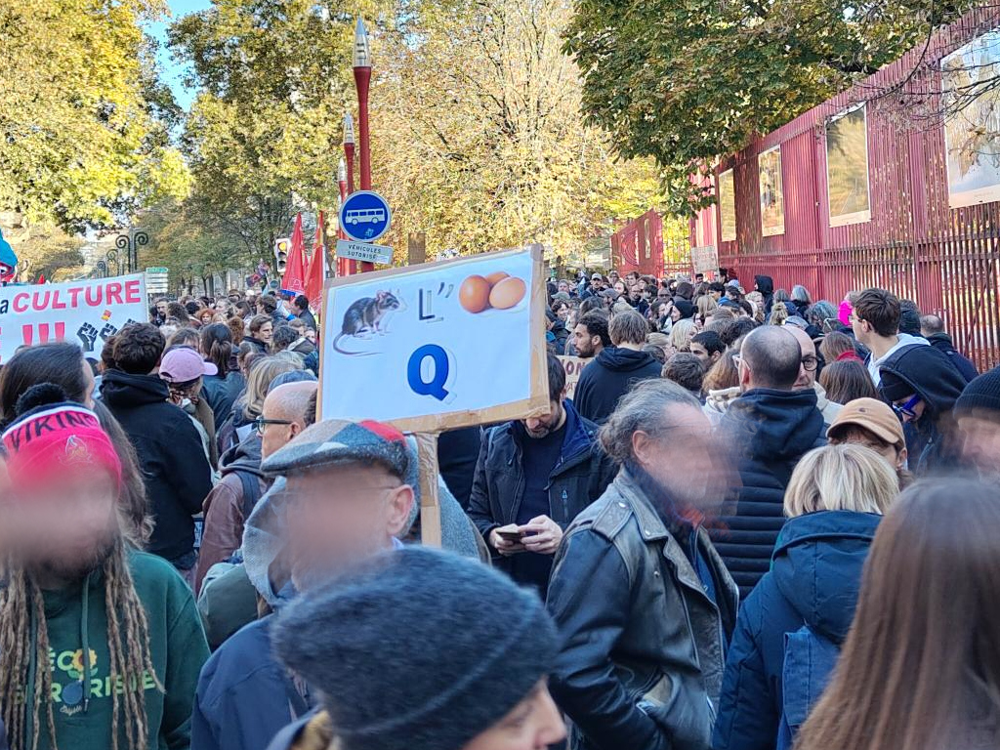

# 1 million de signatures contre CNews : Et après ?

Nous y sommes la pétition, déposée sur le site de l’Assemblée Nationale, exigeant [la fermeture de CNews](https://petitions.assemblee-nationale.fr/initiatives/i-5820?locale=fr) vient de dépasser le million de signatures. Comme nombre, je l’imagine, de lecteur·ices de ce blog, j’ai bien entendu apporté mon soutien à cette dernière.

Cependant, étant donné la faible influence qu’a pu avoir la pétition contre la loi Duplomb ayant obtenu deux millions de signatures, je pense qu’il est nécessaire d’aller plus loin.

## Prendre le problème à la racine

Je pense, par ailleurs, que fermer CNews ne résoudra absolument pas le problème du contrôle des médias par les ploutocrates que représentent les milliardaires Bolloré, Stérin, Dassault, Bouygues et consors.

Et même si je me réjouis que des figures telles que Mathieu Pigasse, dans cette période, portent des projets alternatifs comme Radio Nova, je ne pense pas qu’il faille se contenter de faire l’aumône aux milliardaires de « gauche » (si tant est que l’on puisse être de gauche, milliardaire, et, surtout, le rester).

CNews n’est qu’une des têtes d’un hydre dont l’origine est bien plus profonde. Aussitôt coupée, elle sera immédiatement remplacée par d’autres canaux.

La réalité est simple, derrière le petit écran, les milliardaires abusent de leur pouvoir économique pour influer sur l’opinion publique. Parfois, uniquement pour les affaires, d’autres fois, plus sinistrement, pour mener une guerre idéologique à l’État de droit, aux fondements universalistes de notre République.

Ceci est permis par l’extrême concentration des capitaux induite par le néolibéralisme et son capitalisme débridé. Une fuite en avant amplifiée par la politique actuelle d’Emmanuel Macron. Une politique consistant à permettre aux personnes les plus aisées de faire sécession de la fiscalité, donc de la fraternité, pourtant à la base du pacte Républicain.

## Vers un quatrième pouvoir séparé du cinquième

Si les médias, aussi appelés quatrième pouvoir, sont aussi peu représentatifs de la population, en tout cas de ses intérêts, c’est parce que l’économie, que nous pourrions nommer le cinquième pouvoir, n’est pas suffisamment séparée de ce dernier.

Il est temps aujourd’hui d’acter le fait que la presse, les médias d’information doivent faire figure d’exception et ne pas entrer dans les schémas économiques classiques. Il est inacceptable que les médias soient vecteurs d’une déstabilisation de notre République.

Aujourd’hui l’État subventionne déjà largement les médias à travers des subventions directes et des avantages fiscaux indirects, amplifiant le hold up informationnel de ces milliardaires sur fonds publics.

De plus, les médias détenus par des milliardaires sont souvent déficitaires et renfloués par ces derniers. Ainsi, nous observons une situation qui pourrait s’apparenter à un dumping informationnel où des organes médiatiques sont maintenus sous perfusion alors même que le public ne les plus plébiscite pas au point de les rendre viables économiquement.

## Tout média subventionné doit être coopératif

C’est la raison pour laquelle je suis favorable à une loi inscrivant l’obligation pour tous média, organe de presse ou site internet d’information (hors associations), d’avoir un statut coopératif pour pouvoir bénéficier de subventions publiques.

Les sociétés coopératives d’intérêt collectif (SCIC) sont un modèle tout à fait efficient pour remettre au centre de la décision concernant la ligne éditoriale, toutes les parties prenantes sur le principe d’une personne égale une voix.

Au premier titre, bien sûr, les journalistes. En effet, la plupart des journalistes ont une déontologie et la respectent. Avec un tel modèle, il me semble important que le collège des journalistes ait un poids considérable dans la décision.

Ensuite, les lecteur·ices, téléspectateurs·ices ou auditeur·ices. Effectivement, ces derniers seraient les garant·es d’une ligne éditoriale correspondant à un besoin avéré. Ils pourraient également distribuer par leur engagement en tant sociétaire des subventions publiques sur un principe équivalent à la licence globale.

Enfin, de manière à introduire un contrôle citoyen dans ces organes décisionnels, tout à chacun pourrait, sans condition, devenir sociétaire de ces coopératives d’intérêt collectif en tant que citoyen·ne. Ce collège citoyen minoritaire serait le garant d’une contradiction et d’un contrôle sur les lignes éditoriales afin de respecter l’esprit républicain, l’idée de pluralisme et surtout un journalisme qui s’attache au fait. En dernier ressort, il trancheraient les désaccords entre les collèges de journalistes et d’usager·es.

Pour permettre aux médias actuels de s’adapter sans choc brutal, cette obligation de mutation pourrait s’échelonner progressivement avec une baisse progressive des subventions et une période d’adaptation de 5 ans environ. Cela leur permettra d’ouvrir leur capital décisionnel progressivement aux différents collèges précités.

Bien sûr, afin de prendre en compte toutes les situations et toutes les potentielles difficultés causées par cette transition, il faudra mettre en œuvre une concertation avec toutes les parties prenantes de ce projet.

## Une mesure au coût nul pour la collectivité

Une loi qui obligerait toutes les structures actuelles à passer sous le statut de société coopérative d’intérêt collectif pour recueillir des subventions ne coûterait, de plus, rien du tout à l’État.

En effet, un média au sein duquel un milliardaire serait actionnaire majoritaire restera actionnaire majoritaire. Simplement, selon le principe d’une personne égale une voix, ce dernier n’aurait qu’une voix correspondant à sa personne au sein du collège dont il ferait partie. Dans le cas contraire, ce dernier devra simplement assumer de financer lui-même son média sans l’aide de l’État.

Nul besoin de nationaliser, nul besoin de spolier, simplement un rééquilibrage de la gouvernance, protégeant le quatrième pouvoir du pouvoir économique serait opéré en toute transparence, en toute objectivité.

## Un pluralisme assuré

Le gros avantage de ce système est qu’il y aura toujours des médias plutôt à droite, plutôt à gauche, voire d’extrême droite ou d’extrême gauche ? Simplement, ce seront les journalistes et les usager·es de ces médias qui décideront ensemble de la ligne éditoriale, de son évolution, de l’organisation interne du média et de la façon dont les faits, les opinions seront rapportés, traités.

Je ne fais pas partie de ceux qui pensent que l’information peut être dans l’absolu objective. Le problème n’est pas qu’un média soit de droite ou de gauche, le problème est qu’un média soit au service d’une personne et touche des millions d’autres. En matière de démocratie et de préservation de l’idéal républicain, un tient vaut mieux que deux tu l’auras. C’est pourquoi nous devons mettre en place une telle loi.

Aujourd’hui, un grand nombre de modèles économiques sont règlementés, Il ne s’agit en aucun cas d’une atteinte au droit d’entreprendre. La création de sociétés coopératives d’intérêt collectifs est libre. Simplement, le quatrième pouvoir, comme les trois qui le précèdent, ne peut s’exercer seul du haut d’une tour d’ivoire.

## Un verrou constitutionnel voire européen possible

Il est possible qu’une telle proposition de loi soit rejetée au niveau du Conseil constitutionnel, au regard de la liberté d’entreprendre et potentiellement du droit de propriété.

Ce qui pose la question d’une révision de la constitution, voire d’une prise en compte lors d’une constituante amenant à l’établissement d’une sixième république. Au même titre que l’exception culturelle française, elle pourrait invoquer l’exigence démocratique française. Étant donné que les organes médiatiques sont des biens communs importants pour le maintien de la démocratie, garantir l’indépendance et une gouvernance plurielle permet une séparation stricte du quatrième pouvoir avec le pouvoir économique privé démesurément grand dans notre société néolibérale.

Reste le verrou potentiel de l’Europe. Cependant, la formation d’une sixième république suite à une constituante formerait un argument fort pour la réévaluation de certains principes donnant trop de poids à la liberté d’entreprendre ou à la propriété privée qui aujourd’hui menace nos démocraties à l’échelle du système entier, si ce n’est à une échelle transnationale.

Reste que l’argument de la liberté d’entreprendre ou de la propriété privée ne s’applique pas forcément aux subventions, auquel cas n’importe qui pourrait réclamer des subventions au titre de la liberté d’entreprendre ou de la propriété privée, ce qui pourrait tout de même apparaître comme incongru.

C’est en tout cas un paramètre à prendre en compte pour une extension de la loi à tout média, pas uniquement à ceux subventionnés.

## La question des réseaux sociaux

Aujourd’hui, avec les réseaux sociaux, une grande partie de l’information échappe totalement aux médias traditionnels. L’argent injecté dans ces derniers par les milliardaires pourrait tout à fait l’être à la place dans les réseaux sociaux.

Le fait est qu’il est probable que ce soit déjà le cas. Ceci dit, j’ai traité ce sujet dans [un autre article le sujet des réseaux sociaux](./reseaux-sociaux-vraiment) qui, je pense, nécessitent également une régulation, a fortiori face à l’avènement de l’intelligence artificielle.
